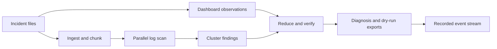

# CrashCart

CrashCart helps explain failures in multi-node GPU training jobs by scanning rank and kernel logs, reading a synthetic telemetry dashboard, grouping repeated symptoms, and checking every quoted citation against its source before it produces a diagnosis, postmortem, and dry-run runbook. The sample incidents are synthetic and the app is designed to run offline in mock mode.

## Quick start

```sh
git clone <repo-url> crashcart && cd crashcart
./run.sh
# Paste your Token Factory API key at the hidden prompt.
```

The launcher creates the environment, installs dependencies, generates sample incidents, runs Gate 0 when needed, and starts the app. Use `./run.sh mock` to start without a key. The manual setup instructions remain below.

## Demo

Demo: [add demo URL](DEMO_URL_PLACEHOLDER)<br>
Video: [add public video URL](VIDEO_URL_PLACEHOLDER)

## Screenshot

Screenshot not yet captured. Add a console screenshot after the mock replay is recorded.

## How it works



## Where each Nemotron model is used

| Role | Model ID | Why |
|---|---|---|
| Swarm | `nvidia/Nemotron-3_5-Lightning` | Scans individual log chunks in parallel. |
| Reduce | `nvidia/Nemotron-3-Ultra-550b-a55b` | Combines grounded findings into a diagnosis. |
| Baseline | `nvidia/Nemotron-3-Ultra-550b-a55b` | Diagnoses only the tail of the first rank log for comparison. |
| Eyes | `LLM_MODEL_EYES` is not yet set | Reads the dashboard image; the provider model ID must be filled from the human smoke test. |
| Skeptic | `nvidia/nemotron-3-super-120b-a12b` | Suggests an alternative explanation and a settling check. |

Model IDs are configurable in `app/config.py` and `.env`. Provider support and the Eyes model ID are not yet verified by the live smoke test.

## Where Nebius Token Factory accelerated this

| Measure | Result |
|---|---|
| System comparison | not yet measured; `eval/results.json` does not exist. |
| Swarm parallel versus sequential timing | not yet measured; run `tools/run_eval.py --sequential-compare 1` after generating incidents. |

## Nebius services used

Nebius Token Factory is the configured OpenAI-compatible model API. Nebius Serverless Endpoints have not been deployed.

## Results

not yet measured. Generate `eval/results.json` with the evaluation harness, then run `python tools/make_report.py` to produce `eval/RESULTS.md` and `eval/chart.png`. The README results table must be copied from those generated outputs after evaluation; do not enter hand-measured or estimated performance figures here.

## Synthetic data disclosure

The included incident bundles and telemetry dashboards are synthetic, deterministic fixtures. Their `truth.json` files are reserved for the evaluation harness and the post-run truth badge; the incident analysis pipeline does not read them. No real job logs or telemetry are included.

## Setup and run

### Mock mode

Install the pinned dependencies from `requirements.txt`, then run:

```sh
python tools/make_incident.py --all --seed 7
LLM_MODE=mock uvicorn app.main:app --reload
```

Open the local app in a browser and choose a synthetic incident. Mock mode needs no API key or network access.

### Live mode

Copy `.env.example` to `.env`, set `LLM_MODE=live`, configure `LLM_BASE_URL` and `LLM_API_KEY` (or the `NEBIUS_API_KEY` fallback), and set the provider model IDs. The live Gate 0 smoke test in `tools/smoke_test.py` is a human-run step and has not been completed. Never commit `.env`.

### Tests

Run offline tests with `LLM_MODE=mock pytest -q`.

### Docker

Build and run the mock image with Docker when the pinned dependencies are available locally:

```sh
docker build -t crashcart:mock .
docker run --rm -p 8080:8080 crashcart:mock
```

The offline build was attempted, but dependency installation could not complete without network access.

## Limitations

- The dataset contains synthetic incidents; live evaluation is not yet measured.
- Dashboards are synthetic and encode planted telemetry patterns.
- Runbook commands are dry-run suggestions for human review; CrashCart does not execute remediation.
- Provider rate limits, model availability, and live API behavior still need the human smoke test.
- Recorded live replays and a deployed public demo are not yet available.

## License

MIT. See [LICENSE](LICENSE).
